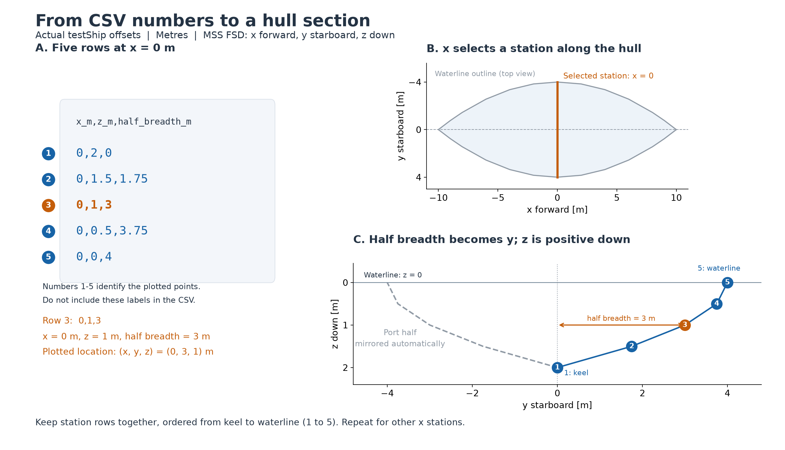

# How to generate offset points using AI

[Back to README](README.md) · [Configure the JSON file](How%20to%20configure%20the%20vessel%20JSON%20file.md)

Use this guide when you have drawings, dimensions, or photographs and need an offset CSV for MSS-Capytaine. If you already have a WAMIT Geometric Data File (GDF), it contains an existing hull panel mesh. Select its `.gdf` file in JSON and skip offset generation; Python reads the panels directly. An existing ShipX MGF also supplies hull sections directly; CSV generation is only needed for the native `capytaine_offsets_csv` route.

An AI assistant can organize known offsets or propose an approximate hull. Dimensions and photographs alone do not uniquely determine underwater shape. Keep the source dimensions and the assumptions with the case so the geometry can be reviewed and improved.

## 1. Collect the source material

Start with the [testShip CSV template](vessels_capytaine/capytaine_offsets_csv/testShip/offset_points.csv) and the closest example case:

- [testShip](vessels_capytaine/capytaine_offsets_csv/testShip/README.md): a surface vessel with sections running from the keel to the waterline.
- [LAUV_marie](vessels_capytaine/capytaine_offsets_csv/LAUV_marie/README.md): a submerged body with sections running from the bottom centerline to the top centerline.
- Otter at [55 kg](vessels_capytaine/capytaine_offsets_csv/otter_55kg/README.md) and [80 kg](vessels_capytaine/capytaine_offsets_csv/otter_80kg/README.md): the same approximate hull at two loads, using one local demi-hull CSV per case and a JSON centerline spacing.

Give the AI the vessel's length, breadth or diameter, draft or body height, and the position of the coordinate origin. Include a lines plan, body plan, station offsets, cross-sections, or scaled drawings when available. Identify bow and stern explicitly; a symmetric example does not define their shape for your vessel. State the loading condition for a surface vessel.

Photographs can help interpret the hull but do not supply submerged offsets by themselves. Ask the AI to distinguish dimensions read from sources from geometry it has inferred. Record the sources and assumptions in the vessel's README. Mass and CG belong in the JSON file and should be supplied separately from the hull shape.

## 2. Use the required CSV convention

The first line must be:

```csv
x_m,z_m,half_breadth_m
```

Use metres and **MSS FSD** throughout:

| Column | Meaning |
| --- | --- |
| `x_m` | Longitudinal coordinate, positive forward. |
| `z_m` | Vertical coordinate, positive down. |
| `half_breadth_m` | Nonnegative distance from the centerplane to starboard. |



The figure uses the five rows at `x_m = 0` in the [testShip CSV](vessels_capytaine/capytaine_offsets_csv/testShip/offset_points.csv). For example, `0,1,3` means x = 0 m, z = 1 m down, and half breadth = 3 m to starboard: the plotted point is (x, y, z) = (0, 3, 1) m. The numbered labels connect the rows to the points; they are not part of the CSV. Only the starboard half is supplied; the program mirrors it to port.

For a surface vessel, put the origin at midships on the design waterline. Underwater points have z >= 0. Each section starts at the centerline keel and ends at the waterline, z = 0. Rows run **bottom to top**, so their z values decrease or stay equal. Equal z values can describe flat-bottom corners, but consecutive points must not be identical.

For a submerged body, choose a fixed body origin, such as its geometric center. The lower surface then has positive z and the upper surface negative z. Each section starts on the bottom centerline and ends on the top centerline, with half breadth zero at both ends. The operating depth is a separate JSON setting, `submergence_depth_m`; do not add it to CSV z values.

Provide at least three distinct longitudinal stations. Keep each station's rows together and ordered bottom to top; station groups can be listed in either x direction. Every station needs at least two distinct profile points. Use enough stations and profile points to describe changes in shape. The program resamples these sections and mirrors the half hull to port.

Each CSV describes a locally symmetric hull whose half-section can be described by a bottom-to-top profile. For two identical demi-hulls, generate offsets for **one** demi-hull and set `demihull_spacing_m` in JSON. Half breadth is measured from that demi-hull's own centerline; do not add the separation to the CSV coordinates or put disconnected sections in one profile. The mesher builds two full hulls at y = ±spacing/2 and solves them together. Use total vessel mass, combined CG and complete-vessel inertia in JSON. See the [twin-hull configuration guide](How%20to%20configure%20the%20vessel%20JSON%20file.md#twin-hulls-and-catamarans). Appendages, overhangs, asymmetric demi-hulls and more complex geometry may require a separately prepared panel mesh.

## 3. Give the AI a precise request

Attach the template and source material, then copy and adapt this prompt. Fill in the bracketed values before using it.

```text
Create an offset_points.csv for MSS-Capytaine from the attached template
and vessel material.

Vessel: [name]
Type: [surface vessel or fully submerged body]
Loading condition: [draft and load condition, or not applicable]
Length and reference definition: [value in metres; Lpp, overall length, etc.]
Maximum breadth or diameter: [value in metres]
Draft or body height: [value in metres]
Origin: [midships at the design waterline, or specified body-fixed origin]
Bow and stern: [identify them in the source material]
Source dimensions and sections: [describe the supplied material]
Requested station locations: [list or ask for a justified distribution]

Use only these CSV columns: x_m,z_m,half_breadth_m.
Use metres and MSS FSD coordinates: x forward, y starboard, z down.
Half breadth is a nonnegative distance to starboard.
Give one row per point, with no comments, units, or prose inside the CSV.
Use finite numeric values and at least three distinct stations.

Within every station, order points bottom to top, with nonincreasing z.
Start at the bottom centerline with half breadth zero.
For a surface vessel, use z >= 0 and end at the waterline, z = 0.
For a submerged body, end at the top centerline with half breadth zero;
use coordinates relative to the body origin without adding operating depth.
Repeated z values are allowed for flat corners, but no consecutive points
may be identical. Preserve bow/stern differences supported by the sources.

Use the source data where available. Identify missing dimensions and state
any inferred hull shape separately. Do not claim the inferred offsets are
measured geometry. Report length, breadth, vertical extent, and your method
for checking displacement. If the evidence is insufficient, list what is
missing before proposing a clearly labelled idealized hull.

Deliver the CSV plus a separate short note of sources, assumptions, and
checks. Keep the CSV coordinate convention exactly as specified.
```

For the [synthetic testShip](vessels_capytaine/capytaine_offsets_csv/testShip/README.md), an analytic half-breadth formula is available. Asking the AI to sample a known formula gives reproducible offsets; it does not reconstruct an unknown vessel.

## 4. Review and save the offsets

Check the returned CSV against the drawings and dimensions before using it:

1. Confirm units, origin, bow/stern orientation, and FSD signs. For a surface hull, underwater z must be positive, with the waterline at zero.
2. Check the section ordering, nonnegative half breadths, and centerline endpoints. Keep explanations and Markdown fences out of the saved CSV.
3. Compare the maximum breadth, draft or body height, and longitudinal extent with the intended geometry. Total x extent need not equal Lpp.
4. Inspect sections for abrupt jumps, unintended asymmetry between bow and stern, and unrealistic flat or pinched regions. Extra interpolation cannot recover shape that was missing from the source data.

Save the file as `vessels_capytaine/capytaine_offsets_csv/myVessel/offset_points.csv`. Save the sources and assumptions in `vessels_capytaine/capytaine_offsets_csv/myVessel/README.md`.

## 5. Configure, solve, and inspect

Follow [How to configure a JSON file](How%20to%20configure%20the%20vessel%20JSON%20file.md), and set `"geometry_file": "offset_points.csv"`. MSS FSD is always used. Enter the vessel's mass, FSD CG, and radii of gyration or full inertia matrix independently of the AI offsets. Preview the source sections in MATLAB or GNU Octave before solving; MSS is not required:

```matlab
addpath('/path/to/MSS-Capytaine/matlab')
plotVesselGeometry('myVessel')
```

Then run from the repository root:

```sh
python main.py capytaine_offsets_csv/myVessel
```

Inspect the exported hull in MATLAB or GNU Octave with MSS on the path:

```matlab
addpath(genpath('/path/to/MSS'))
addpath('/path/to/MSS-Capytaine/matlab')
plotVesselGeometry('myVessel')
plotVesselHydrodynamics('myVessel');
```

`plotVesselGeometry` now shows the original sections at the top and the saved Capytaine hull panels at the bottom. Before solving, the bottom subplot displays a message. Both use MSS FSD; geometry plotting itself does not require MSS.

Compare displaced mass and center of buoyancy in `results/hydrostatics.json` with the intended loading condition. The solver warns when specified mass differs from displaced mass by more than 1%. Examine geometry, mass, and loading condition together when resolving a mismatch.

Review mesh-quality, wavelength-resolution, and reciprocity warnings. Increase `samples_per_section` or `number_of_stations` to check numerical convergence. If the hull shape itself is wrong, revise the source offsets first. A completed solve establishes that the file was usable; agreement with known geometry and validation data establishes whether it is useful.
