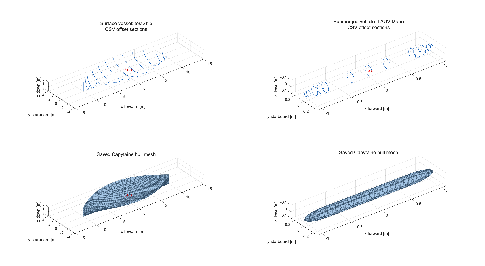

# MSS-Capytaine

**Version 1.0 (2026)**

MSS-Capytaine is a Python add-on for the [Marine Systems Simulator (MSS)](https://github.com/cybergalactic/MSS). It uses the open-source [Capytaine](https://capytaine.org/) boundary-element solver to compute 6-DOF linear potential-flow hydrodynamics and exports the results as the standard MATLAB/Octave `vessel` structure used by MSS.

The project provides an open-source hydrodynamic-data workflow for MSS users without access to the commercial ShipX or WAMIT solvers. Capytaine performs the boundary-element calculations; MSS provides the MATLAB and GNU Octave functions for analysis, model reduction, nonlinear model refinement, plotting, and time-domain simulation.



Geometry previews from `plotVesselGeometry`: the synthetic surface vessel **testShip** and idealized submerged vehicle **LAUV Marie**. Source offset sections are shown above the saved meshes; red crosses mark the CG. Each column has matching axes for comparison. These are example geometries, not measured hull reconstructions.

**Validation highlight:** For the supplied tanker, Capytaine agrees closely with the WAMIT reference: relative norm differences are **below 0.7% for diagonal added mass, 1.8% for diagonal radiation damping, and 0.7% for complex excitation forces**, over 0.0424–1.8003 rad/s. This is a strong numerical check of the Capytaine-to-MSS workflow. See the [results and interpretation](#tanker-comparison-with-wamit) and the [Python comparison test](tests/compare_tanker_wamit.py).

Supply your own hull geometry through any of four input formats:

| Catalogue group | Geometry input | What MSS-Capytaine does |
| --- | --- | --- |
| **`capytaine_offsets_csv` — default** | Your own CSV hull-section points | Generates panels using free, open-source software. No commercial software or licence is required. |
| `mesh_stl` | An existing STL triangle mesh in metres and MSS FSD | Reads the panels directly; accepts ASCII and binary STL. |
| `shipx_mgf` | ShipX/VERES MGF hull sections | Clips to the selected draft and generates panels. |
| `wamit_gdf` | WAMIT Geometric Data File containing a hull panel mesh | Loads the panels with Capytaine's native GDF reader, including symmetry. |

MGF, GDF and STL supply geometry, not precomputed added mass, damping or wave-force results. Capytaine computes these results without requiring a commercial ShipX or WAMIT solver.

The [catalogue](vessels_capytaine/README.md) includes CSV examples [testShip](vessels_capytaine/capytaine_offsets_csv/testShip/), [LAUV_marie](vessels_capytaine/capytaine_offsets_csv/LAUV_marie/), and approximate Otter twin-hull cases at [55 kg](vessels_capytaine/capytaine_offsets_csv/otter_55kg/) and [80 kg](vessels_capytaine/capytaine_offsets_csv/otter_80kg/), the public [Wigley STL](vessels_capytaine/mesh_stl/wigley/), the ShipX [supply vessel](vessels_capytaine/shipx_mgf/supply/), and the WAMIT [tanker](vessels_capytaine/wamit_gdf/tanker/). These demonstrate the workflow; geometry, physical properties and numerical convergence still require validation.

Author: Thor I. Fossen

## Guides for new users

- [How to configure a JSON file](How%20to%20configure%20the%20vessel%20JSON%20file.md): create a case, choose CSV, MGF, GDF or STL geometry, enter mass and CG in MSS FSD, and configure frequencies, mesh resolution, and damping.
- [How to generate offset points using AI](How%20to%20generate%20offsets%20points%20using%20AI.md): prepare source material, use a copyable prompt, and check the resulting CSV.

## MSS Toolbox Integration

Each vessel has a folder `vessels_capytaine/<format>/<vessel>/` containing `config.json`, its geometry, a README and results after solving. The parent group identifies the input route and the vessel name stays simple. JSON centers, CSV points, STL vertices, full inertia matrices, exported panels and plots use **MSS FSD: x forward, y starboard, z down**. MGF/GDF files retain their standard conventions; Python handles conversion internally.

1. Create a case using the [JSON guide](How%20to%20configure%20the%20vessel%20JSON%20file.md). If needed, generate the hull CSV using the [AI offset guide](How%20to%20generate%20offsets%20points%20using%20AI.md).
2. Run `python main.py capytaine_offsets_csv/myVessel`. Inspect accuracy warnings and check mesh convergence; refine CSV/MGF sampling or the source GDF/STL mesh as needed.
3. Inspect the mesh and hydrodynamics with `plotVesselGeometry('myVessel')` and `plotVesselHydrodynamics('myVessel')` in MATLAB or GNU Octave.
4. Copy `vessels_capytaine/<format>/myVessel/results/myVessel.mat` to `MSS/HYDRO/vessels_capytaine/myVessel/`.
5. Run MSS [SIMhydroVessel.m](https://github.com/cybergalactic/MSS/blob/master/CRAFT/SIMhydroVessel.m) to simulate the baseline model, then calibrate and validate it for the intended use.

The saved hydrodynamic arrays remain compatible with MSS, but the current MSS surface-vessel loader still expects `kappa_126` rather than the new `T_126` damping inputs. Loading a MAT file does not automatically migrate that interface: a preset with its own damping override may continue using percentages, while a case that relies on the saved defaults can reject the new metadata. Adopting `T_126` in MSS requires the corresponding loader and processing update, which is postponed. The local `plotVesselHydrodynamics` helper already supports it; no BEM rerun is needed for this migration.

### MSS model refinement and validation

The exported mass, added-mass, radiation-damping, restoring, and wave-excitation data define a linear model about the selected equilibrium condition. They are not, by themselves, a validated nonlinear maneuvering model. Experimental data can come from model-basin tests, free-decay tests, captive tests, or full-scale trials; recorded input-output time series can also be used for parameter estimation. The calibration data should cover the operating conditions in which the model will be used.

MSS [`hydroVessel.m`](https://github.com/cybergalactic/MSS/blob/master/CRAFT/hydroVessel.m) shows how to extend this baseline with the velocity-dependent rigid-body and added-mass Coriolis–centripetal matrices, ITTC-1957 quadratic surge resistance, strip-theory cross-flow drag, and quadratic roll, pitch, and yaw damping. The supporting MSS functions include `rbody`, `m2c`, `XuuITTC`, and `crossFlowDrag`. Application models can additionally represent the forces and moments produced by control surfaces, thrusters, and propellers, together with relevant actuator dynamics and limits. These nonlinear terms and their coefficients are modeling assumptions; calibrate them against measurements and validate the complete model on data that were not used for calibration.

MSS-Capytaine converts the Capytaine results to the MSS conventions before export:

- Six degrees of freedom ordered as surge, sway, heave, roll, pitch, and yaw;
- Forward-starboard-down (FSD) body axes;
- Hydrodynamic matrices referenced to the CG;
- Wave headings expressed as MSS propagation directions on the fixed 10° grid;
- Zero vessel speed for the current Capytaine calculation; and
- A full 0°–350° directional set obtained by mirroring the symmetric 0°–180° solution.

The exported `vessel` structure contains:

| Field | Contents |
| --- | --- |
| `main` | Vessel particulars, mass properties, centers, and metacentric heights |
| `MRB` | Rigid-body mass matrix |
| `A` | Zero-, finite-, and infinite-frequency added mass |
| `B` | Potential damping |
| `C` | Hydrostatic restoring matrix |
| `forceRAO` | First-order wave-excitation force RAOs |
| `motionRAO` | First-order motion RAOs computed with potential damping `B` |
| `freqs` | Coefficient frequency grid |
| `headings` | Full directional grid |
| `velocities` | Vessel-speed grid, currently `[0]` |
| `powerBased` | Inputs used by MATLAB to compute the constant power-based `Bv` |

For surface vessels, `vessel.main.CF` stores the center of flotation in the same MSS FSD body coordinates as `vessel.main.CG` and `vessel.main.CB`. Thus `x_F = CF(1) - CG(1)`. The hydrostatic restoring matrix is constructed as `G35 = G53 = -G33*x_F` and includes the corresponding `G33*x_F^2` contribution in `G55`.

Pre-generated copies are included in the MSS [`HYDRO/vessels_capytaine`](https://github.com/cybergalactic/MSS/tree/master/HYDRO/vessels_capytaine) catalog. You need Python and Capytaine to regenerate the hydrodynamic data, but not to load the included `.mat` files in MSS.

## Requirements

The Python calculation requires:

- Python 3.11 or later;
- Capytaine 3.0 or later;
- NumPy, SciPy, and Xarray; and
- Matplotlib for the optional Python plots.

The current workflow was developed and tested with Python 3.11 and Capytaine 3.0.0. A basic virtual environment can be created with:

```sh
python -m venv .venv
source .venv/bin/activate
python -m pip install capytaine numpy scipy xarray matplotlib
```

On Windows, activate the environment with `.venv\Scripts\activate` instead. MSS is not required for the Python calculation or source-geometry previews. It is required for the MATLAB/Octave hydrodynamic post-processing workflow.

## Quick start

Run the default surface-vessel calculation from the repository root:

```sh
python main.py
```

`main.py` reads `vessels_capytaine/capytaine_offsets_csv/testShip/config.json` and writes the generated files to `vessels_capytaine/capytaine_offsets_csv/testShip/results/`.

List or select grouped catalogue cases (unique short names also work):

```sh
python main.py --list
python main.py capytaine_offsets_csv/testShip
python main.py capytaine_offsets_csv/LAUV_marie
python main.py capytaine_offsets_csv/otter_55kg
python main.py capytaine_offsets_csv/otter_80kg
python main.py shipx_mgf/supply
python main.py wamit_gdf/tanker
python main.py mesh_stl/wigley
```

A direct path to another configuration is also accepted:

```sh
python main.py path/to/config.json
```

Run the submerged LAUV Marie case with:

```sh
python main.py LAUV_marie
```

This writes `vessels_capytaine/capytaine_offsets_csv/LAUV_marie/results/LAUV_marie.mat`. The case uses NTNU's published 2.15 m length and 34 kg mass for Marie, the published 0.15 m OceanScan LAUV-family diameter, and a documented idealized tapered-cylinder hull. Its finite-frequency grid extends to 9.5 rad/s; 10 rad/s remains the plotting location for the separately computed infinite-frequency result.

To inspect either result, add the MSS-Capytaine MATLAB directory to the MATLAB or GNU Octave path. Add MSS too for hydrodynamic post-processing. The result viewers automatically locate and load the generated vessel data.

For `testShip`:

```matlab
addpath(genpath('/path/to/MSS'))
addpath('/path/to/MSS-Capytaine/matlab')
plotVesselGeometry('testShip')
plotVesselHydrodynamics('testShip');
```

For `LAUV_marie`:

```matlab
plotVesselGeometry('LAUV_marie')
plotVesselHydrodynamics('LAUV_marie');
```

`plotVesselGeometry` shows source geometry and the saved Capytaine hull mesh in two subplots. It works before solving too, with a message in the mesh subplot until results are available. `plotVesselHydrodynamics` loads the saved vessel structure, uses MSS to compute the equivalent matrices, applies the exported time constants through a private helper, then uses `plotTF`, `plotABC`, and `plotBv` to inspect the hydrodynamic data. It also calls `vesselPeriods` for surface vessels; fully submerged vehicles have no hydrostatic heave stiffness, so that calculation is skipped automatically.

## Repository layout

```text
main.py                         Run a case; --list shows group/vessel names
plot_results.py                 Plot saved MSS results
src/                            Geometry readers, mesh generation and solver
tests/                          Checks and numerical comparisons
  compare_tanker_wamit.py       Compare saved tanker results with MSS WAMIT
  compare_supply_shipx.py       Compare saved supply results with MSS ShipX
matlab/                         Two public plotting functions
  plotVesselGeometry.m          Source geometry and saved Capytaine mesh
  plotVesselHydrodynamics.m     Saved hydrodynamic results (requires MSS)
  private/                      Internal source/mesh readers and catalogue lookup
vessels_capytaine/
  capytaine_offsets_csv/        Default native CSV workflow
    LAUV_marie/
    otter_55kg/                 Approximate twin hull, no added payload
    otter_80kg/                 Same hull, MSS 25 kg payload
    testShip/
  mesh_stl/
    wigley/                     Adapted public STL; source and licence recorded
  shipx_mgf/
    supply/                     supply.mgf copied from the MSS ShipX archive
  wamit_gdf/
    tanker/                     246 m WAMIT geometry and comparison report
```

Each vessel directory contains `config.json`, the geometry file and a README. Its `results/` folder holds `<vessel>.mat`, hydrostatics and exported panels. The two root-level guides explain configuration and AI-assisted CSV creation.


## Plot geometry and mesh

Geometry uses two rows and one column: source above, saved mesh below, with matching axis limits and linked viewing angles. There are two public MATLAB/Octave plotting functions, both displaying MSS FSD:

| Function | Displays | Needs a completed solve | Needs MSS |
| --- | --- | --- | --- |
| `plotVesselGeometry` | Source geometry (top) and saved Capytaine hull mesh (bottom) | No; mesh shown when available | No |
| `plotVesselHydrodynamics` | Hydrodynamic coefficients, RAOs and damping | Yes | Yes |

Add only `matlab/` to the path; its `private/` support functions are found automatically. Preview source geometry with:

```matlab
addpath('/path/to/MSS-Capytaine/matlab')
plotVesselGeometry('capytaine_offsets_csv/testShip')
plotVesselGeometry('shipx_mgf/supply')
plotVesselGeometry('wamit_gdf/tanker')
plotVesselGeometry('mesh_stl/wigley')
```

The top subplot needs no solve, result file, Python process or MSS installation. CSV/MGF display hull sections (MGF highlights the wetted portions); GDF/STL display source panels. The JSON CG is marked in red. The bottom subplot reads `generated_hull_panels.mat` from the configured `output_dir` (default `results/`) and shows the saved hull panels, without the internal solver lid. It uses the saved vessel CG when available. Before solving it displays a message instead. After editing geometry or meshing settings, rerun Python to refresh the saved mesh; plotting itself never generates or updates it. A unique vessel name or a JSON path also works. When an extension is missing, the reader identifies the file contents.

The README preview is exported from these same MATLAB plots using [exportGeometryPreview.m](tests/exportGeometryPreview.m). With saved meshes available, regenerate it without a BEM solve:

```matlab
addpath('tests')
exportGeometryPreview()
```

## Plot in Python

After running `main.py`, use Matplotlib to plot the saved MATLAB result:

```sh
python plot_results.py
python plot_results.py --heading 90 --show
```

The script reads `vessels_capytaine/capytaine_offsets_csv/testShip/results/testShip.mat` and saves six PNG figures in `vessels_capytaine/capytaine_offsets_csv/testShip/results/plots/`. It does not rerun the hydrodynamics or change the result file. The coefficient plots show the infinite-frequency values as separate markers at the `10 rad/s` label; RAO plots use only finite frequencies.

To plot `LAUV_marie`, pass its result file explicitly:

```sh
python plot_results.py vessels_capytaine/capytaine_offsets_csv/LAUV_marie/results/LAUV_marie.mat
python plot_results.py vessels_capytaine/capytaine_offsets_csv/LAUV_marie/results/LAUV_marie.mat --heading 90
```

These figures are saved in `vessels_capytaine/capytaine_offsets_csv/LAUV_marie/results/plots/`. All six RAO panels use the same frequency limits. At symmetry headings such as 0° and 180°, the sway, roll, and yaw responses are identically zero for a port-starboard symmetric body; their phase is undefined and is labeled as such instead of being plotted on an arbitrary autoscaled frequency axis.

RAO phase figures use the principal interval from -180° to 180°. This maps equivalent 0° and 360° values to the same phase and removes artificial two-pi jumps. Curves are broken at genuine 180° phase reversals, and phase is hidden where the RAO magnitude is negligible, since phase is undefined at a zero response.

## Tanker comparison with WAMIT

**WAMIT is the reference benchmark for the project's 3D potential-flow comparison.** WAMIT and Capytaine both solve three-dimensional radiation and diffraction problems using boundary-element methods. Comparing the same tanker geometry and loading condition provides a direct check of the BEM results and the conversion to MSS conventions.

The [tanker GDF comparison](vessels_capytaine/wamit_gdf/tanker/validation/README.md) compares existing Capytaine and MSS WAMIT results at the same CG in MSS FSD, including added mass, radiation damping, and complex force RAOs. Overlay plots and error tables cover 40 finite samples over 0.0424–1.8003 rad/s:

| Compared quantity | Relative norm differences across the six DOFs |
| --- | ---: |
| Diagonal added mass A | 0.31–0.69% |
| Diagonal radiation damping B | 0.49–1.72% |
| Complex excitation-force RAOs, pooling all 36 headings per DOF | 0.09–0.61% |

**The close agreement supports confidence in the solver workflow and the MSS axis, unit, reference-point and phase conversions.** These percentages are norm differences over the stated frequency band, not maximum errors at every sample. This benchmark checks agreement with an independent numerical solver; it does not establish mesh convergence for every vessel or agreement with experiments. The current tanker grid uses rounded WAMIT frequencies, so the comparison includes interpolation. Higher finite frequencies were excluded following mesh-resolution warnings.

Inspect or reproduce the calculation with the [Python comparison test](tests/compare_tanker_wamit.py):

```sh
python tests/compare_tanker_wamit.py
```

It uses saved results and does not rerun either hydrodynamic solver.

## Supply comparison with ShipX

The [supply comparison](vessels_capytaine/shipx_mgf/supply/validation/README.md) compares saved Capytaine and MSS ShipX/VERES data at the exact 33 ShipX frequency points from 0.1047198 to 1.795196 rad/s, without interpolation. It shifts the reference from its waterline motion point to the actual CG, then compares added mass, potential damping, force RAOs and hydrostatics. Inspect the [Python comparison test](tests/compare_supply_shipx.py) or run `python tests/compare_supply_shipx.py`; neither solver is rerun.

**This is a comparison of different hydrodynamic approximations.** The archived ShipX run uses ordinary strip theory, assembling two-dimensional sectional solutions with approximations to longitudinal three-dimensional effects; Capytaine models the complete three-dimensional hull. This differs from the WAMIT/Capytaine BEM benchmark above. ShipX also offers a separate VERES3D solver; it was not used for this archived supply dataset. See [SINTEF's description of VERES and VERES3D](https://www.sintef.no/en/software/shipx/shipx-vessel-responses-veres/).

Surge is excluded from the error tables and plots because MSS estimates its surge added mass and damping from sway data. The report separates force amplitude and complex errors and explains the method and phase-reference limits. Substantial differences remain after matching frequencies, including pitch-damping norm differences of about 72%. The different theories are a plausible contributor; their individual contributions have not been isolated. Mesh convergence and the archived wave-phase origin still require investigation before assigning all differences to strip theory. This is a diagnostic comparison, not an accuracy acceptance test. See [tests](tests/README.md) for commands and reference-file options.

## Configuration reference

See [How to configure a JSON file](How%20to%20configure%20the%20vessel%20JSON%20file.md) for the complete field reference, FSD origins and signs, CSV/MGF/GDF/STL selection, submerged depth, damping models with [equations and worked examples](How%20to%20configure%20the%20vessel%20JSON%20file.md#viscous-damping-equations-and-examples), and frequency limits. The solver always uses zero forward speed and the fixed 10-degree heading grid.

## Outputs

Panel MAT and NPZ files store MSS FSD `vertices`, `faces`, and `coordinate_system = MSS_FSD`; MAT faces are one-based and NPZ faces are zero-based. These contain the full hull in body-fixed coordinates without the solver lid or submerged equilibrium-depth translation.

`vessels_capytaine/capytaine_offsets_csv/testShip/results/testShip.mat` contains `MRB`, `A`, `B`, `C`, the power-based damping inputs, force and motion RAOs, frequencies, and headings in MSS forward-starboard-down axes at the center of gravity. For a surface vessel, the hydrostatic restoring matrix `C` is confined to the heave, roll, and pitch block. For a fully submerged vehicle, heave waterplane stiffness is zero; `LAUV_marie` has restoring stiffness only in roll and pitch from its assumed vertical CG–CB separation. The exported `vessel.main` structure records the `submerged` flag and nominal `submergenceDepth` used by the free-surface solve.

The coefficient frequency grid includes zero frequency and the infinite-frequency radiation solution, labeled `10 rad/s`. The force and motion RAOs use only the positive finite frequencies below `10 rad/s`. The fixed 19 headings from 0° to 180° in 10° increments are mirrored to the full 36-heading set from 0° to 350° required by MSS.

Every value configured in `omega_rad_s` must be strictly below 10 rad/s. The solver rejects values greater than or equal to 10 because the exporter always reserves and appends 10 rad/s for the separately computed infinite-frequency radiation result.

The results directory also contains `hydrostatics.json` and the generated hull panels in `.mat` and `.npz` formats. The testShip hull and inertia are synthetic demonstration data; numerical accuracy depends on mesh resolution.

## Twin hulls and catamarans

**Monohulls and rigid, port-starboard symmetric catamarans are supported.** Choose the geometry input as follows:

| Input | Catamaran geometry |
| --- | --- |
| CSV offsets | Supply one locally symmetric demi-hull and set `demihull_spacing_m` to the centerline-to-centerline separation. The mesher builds two identical hulls at y = ±spacing/2. |
| STL mesh | Include both hulls at their actual separation in one file, in metres and MSS FSD. |
| WAMIT GDF | Supply the complete assembly, or native symmetry flags that expand to both hulls. |
| ShipX MGF | The current importer handles monohull sections only. |

Use the total vessel mass, combined CG and full-vessel inertia. Both hulls share the same six rigid-body motions, and the panel solve includes their hydrodynamic interaction. Inspect mesh resolution and the internal lid; the open-water gap must remain fluid and must not be covered by artificial hull or lid panels.

The Otter examples use the same assumed physical hull at [55 kg](vessels_capytaine/capytaine_offsets_csv/otter_55kg/) and [80 kg](vessels_capytaine/capytaine_offsets_csv/otter_80kg/) (MSS's 55 kg vessel plus 25 kg payload). Each has its own waterline, equilibrium attitude, CG and full inertia. The 55 kg case finds its changed static heave and trim on the same hull. These are not measured Otter lines or validated wave models. Preview them with `plotVesselGeometry('otter_55kg')` and `plotVesselGeometry('otter_80kg')` before solving.

Asymmetric demi-hulls need complete GDF/STL geometry, with overall port/starboard symmetry for the current heading mirroring. See the [geometry guide](How%20to%20configure%20the%20vessel%20JSON%20file.md#twin-hulls-and-catamarans).

The power-based weighting peak is selected during MSS post-processing: `plotVesselHydrodynamics('otter_55kg', 1.5)` uses 1.5 rad/s; omitting the second argument uses an illustrative 0.8 rad/s default. This reweights saved A/B data without a Python rerun. See the [JSON and processing guide](How%20to%20configure%20the%20vessel%20JSON%20file.md#what-mss-computes) for interpretation.

Surface JSON damping inputs now use **`T_126` in seconds** for total surge, sway and yaw velocity-decay targets, together with `delta_zeta_345` for the restored modes. The former `kappa_126` percentage field is rejected with migration instructions. Submerged `T_1236` inputs are unchanged. MATLAB prints specified time constants beside the potential-flow maximum values and stops if a target requires negative additional viscous damping. These are diagonal equivalent-model targets; coupled decay times can differ.

After editing only damping inputs, update the saved MAT metadata without BEM:

```sh
python main.py shipx_mgf/supply --update-damping
```

Then call `vessel = plotVesselHydrodynamics('supply')` to obtain the processed model and plots. The local private helper supports these inputs with the existing MSS; the separate MSS interface update is postponed. Do not pass time constants into an older MSS function's percentage argument. Geometry, mass and frequency changes still require the appropriate new solve/export.

## Current scope and limitations

- The calculation is restricted to zero forward speed.
- The exported RAOs are first-order; second-order wave-drift loads are not computed.
- Directional mirroring assumes a port-starboard symmetric rigid vessel.
- Catamaran hulls move together as one rigid vessel; independent hull motions and structural flexibility are outside the current model.
- Zero- and infinite-frequency radiation calculations currently require infinite water depth.
- Mesh convergence and frequency-range convergence must be checked for each new hull.

## Recommended citation

If you use MSS-Capytaine in your work, please cite the software as:

> Fossen, Thor I. (2026). *MSS-Capytaine* [Computer software]. GitHub. https://github.com/cybergalactic/MSS-Capytaine

BibTeX:

```bibtex
@software{Fossen2026_MSScapytaine,
  author  = {Fossen, Thor I.},
  title   = {MSS-Capytaine},
  year    = {2026},
  url     = {https://github.com/cybergalactic/MSS-Capytaine}
}
```

## Related projects

- [MSS](https://github.com/cybergalactic/MSS) — MATLAB and GNU Octave marine systems simulation library.
- [Capytaine](https://github.com/capytaine/capytaine) — Python boundary-element solver for linear potential-flow hydrodynamics.
