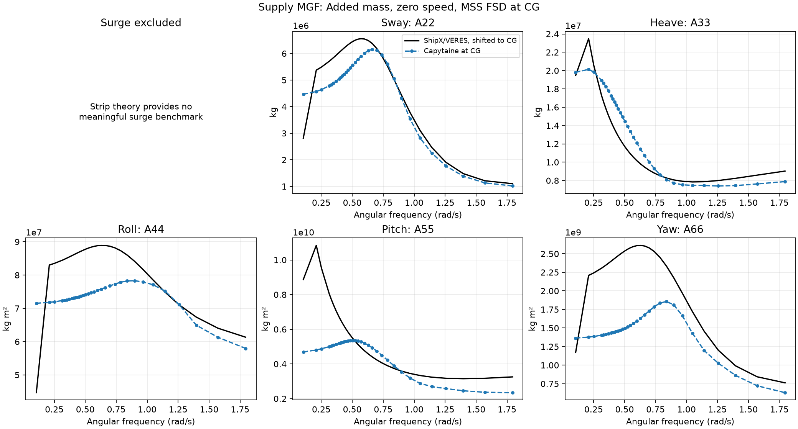
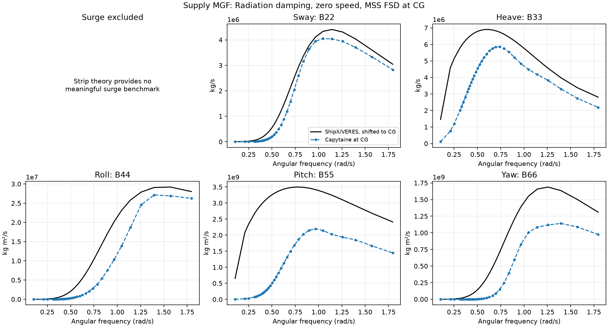
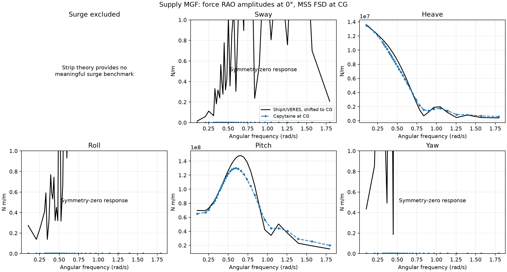
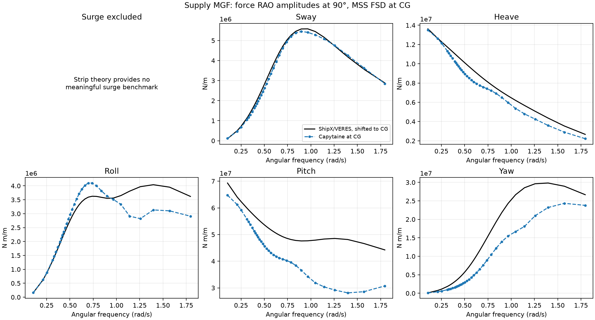
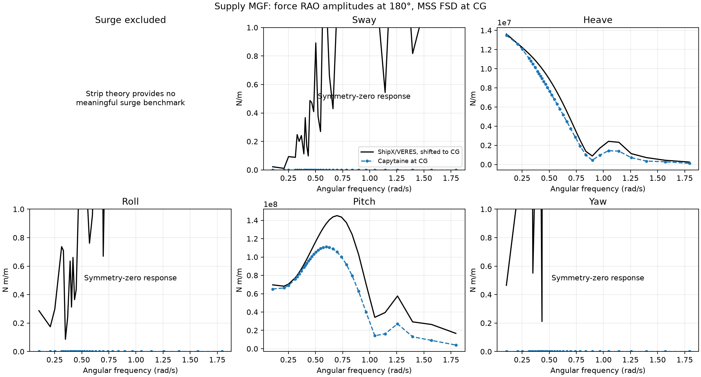

# Supply MGF versus MSS ShipX/VERES

Finite comparison band: **0.10472–1.7952 rad/s**, 33 samples, 36 headings at zero speed.

## Alignment

The two datasets use the same supply-vessel MGF, design draft, mass and CG. Both are compared in SI units and MSS FSD. Capytaine input: `supply.mat` in this case’s `results/` folder. ShipX reference: `supply.mat` from the MSS ShipX supply case. The shipped ShipX `input.out` selects ordinary strip theory (IMETH=1), a motion reference vertically at the waterline (IMTNCOORD=1), viscous damping and roll tanks. The saved MSS reference label is `CG`, but its rigid-body translation/rotation coupling implies a displacement to the actual CG of [0, 0, -1.3] m. For the archived supply reference, the point is longitudinally at CG and vertically at the waterline, as recorded in `input.re7` and `input.re8`. The diagnostic JSON records the point inferred from the actual saved mass matrix, so a future export already shifted to CG is handled without a second shift. For r from that point to CG, H = [[I, skew(r)], [0, I]]. Use Hᵀ A H, Hᵀ B H and Hᵀ C H for matrices, and Hᵀ F for excitation forces. The shifted rigid-body mass matrix agrees with the configured Capytaine CG inertia to 8.22943e-06% in relative norm.

The script derives the displacement from mass coupling; it does not assume that an older reference-point label is correct. It rejects mismatched loading conditions or axes. Select the zero-speed entry, including only its first populated speed slot in the legacy RAO cells. The same 36 MSS propagation headings are used without reversing them again. **No frequency interpolation is used.** The supply JSON uses the exact ShipX frequency samples up to 1.8 rad/s. Reference coefficients and complex forces are selected directly at those samples; a mismatched grid produces an error. Zero and the 10 rad/s infinity marker are excluded; ShipX has no matching limiting solutions. No phase correction is fitted. The archived ShipX run specifies a 5 m regular-wave amplitude. This does not change linear A, B or excitation transfer functions normalized per metre of wave amplitude. It can affect equivalent viscous roll damping in motion calculations, which are excluded here.

## Relative errors

**Surge is excluded from all error tables and plotted comparisons.** Ordinary strip theory does not provide a meaningful surge benchmark; MSS estimates A11 and B11 from sway. Comparisons cover sway, heave, roll, pitch and yaw only.

Each percentage is 100 × ||Capytaine − ShipX||₂ / ||ShipX||₂ over this band, not a maximum pointwise error. Matrix rows use diagonal entries; force errors pool all 36 headings for each DOF. These are unweighted norms over the nonuniform native frequency samples, not frequency-integrated errors. Percentages from a different grid are not directly comparable because the sample weighting changes. Complex forces are reconstructed as amplitude × exp(i × phase) using the stored MSS phases. Their errors include phase differences; no spatial wave-phase origin adjustment is assumed or fitted. Amplitude errors are shown separately.

| DOF | Added mass | Radiation damping | Complex force RAO | Force amplitude |
| --- | ---: | ---: | ---: | ---: |
| Sway | 13.56% | 14.25% | 16.28% | 4.85% |
| Heave | 15.81% | 38.04% | 14.13% | 8.71% |
| Roll | 14.24% | 34.00% | 36.35% | 10.79% |
| Pitch | 31.88% | 71.67% | 31.38% | 18.25% |
| Yaw | 36.13% | 43.79% | 32.61% | 15.20% |

## Hydrostatic checks

| Quantity | Capytaine | ShipX | Difference |
| --- | ---: | ---: | ---: |
| m | 6.36221e+06 | 6.36221e+06 | +0.000% |
| nabla | 6189.4 | 6207.03 | -0.284% |
| GM_T | 2.11162 | 2.144 | -1.510% |
| GM_L | 95.2518 | 103.628 | -8.083% |
| GM_L (common stiffness definition) | 95.2518 | 97.8661 | -2.671% |

Stiffness-entry differences after shifting to CG: C33: -0.924%, C35: -6.830%, C44: -1.778%, C55: -3.473%.

The stored ShipX GM_L scalar and the value derived from its restoring matrix use different conventions. The common-definition row uses (C55 − C35²/C33)/(rho g volume) for both datasets; the stored-scalar difference alone is not a measure of geometry error.

## Interpretation and limits

- Capytaine solves a three-dimensional panel model; this ShipX run uses ordinary strip theory. Differences are not a solver pass/fail criterion and cannot be attributed to frequency limits alone.
- MSS `ABCtransform` estimates ShipX A11 and B11 by scaling sway coefficients. These estimates are excluded from validation. Full six-DOF frame transformations are still applied before selecting the five compared DOFs, so the remaining forces and moments use the correct reference point. Strip theory also omits some longitudinal coupling terms.
- The MGF is resampled and closed for Capytaine. Its volume is about 0.28% smaller; geometry discretization and strip-theory assumptions can affect agreement. A short hydrostatics check doubling samples and stations (24/70 to 48/140) changed volume by about 0.04% and common-definition GM_L by about 0.04%; this does not establish convergence of A and B.
- Complex force differences use the archived MSS phases. They should not be interpreted as pure hydrodynamic-model error without independently confirming the incident-wave phase origin in both calculations.
- Motion RAOs are not compared: the ShipX run includes viscous damping and roll tanks, while exported Capytaine motion RAOs use potential damping only. Second-order drift is not computed by this Capytaine workflow.
- No experimental data or acceptance tolerance is used. These are comparisons of saved numerical datasets. Neither solver is rerun.

## Plots

Inspect the [Python comparison test](../../../../tests/compare_supply_shipx.py).

Reproduce from the repository root with `python tests/compare_supply_shipx.py`. Use `--shipx path/to/supply.mat` for another MSS checkout and `--max-omega` to reduce the band. `--output-dir` selects a separate report directory.
