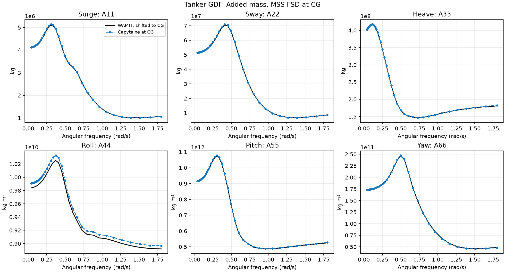
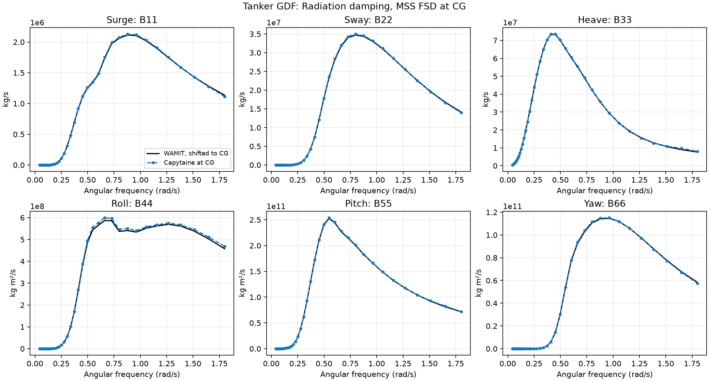
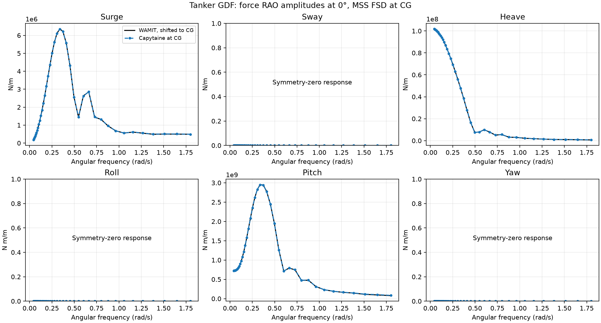
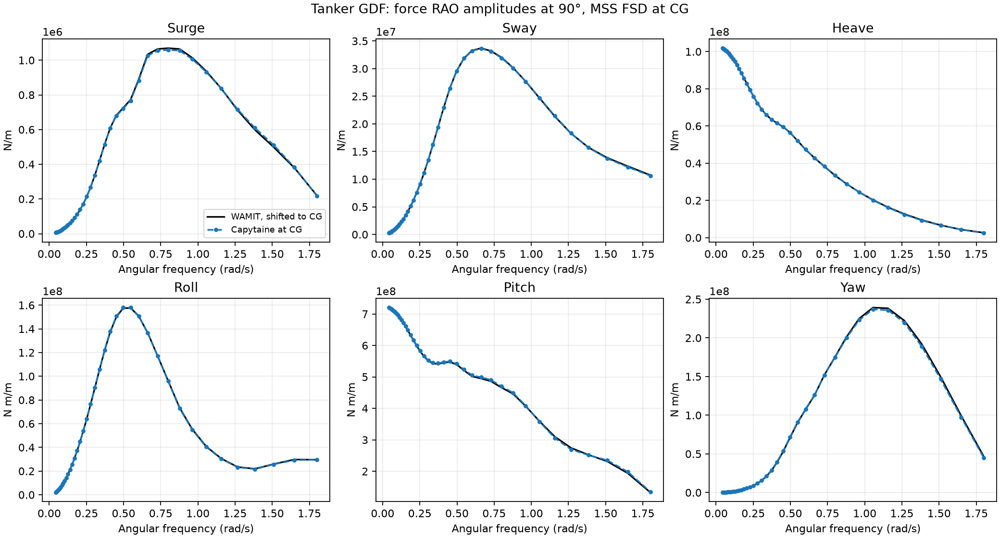
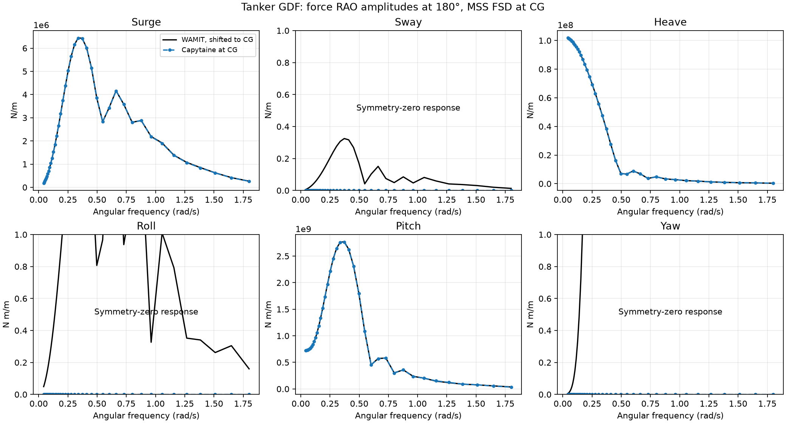

# Tanker GDF versus MSS WAMIT

Finite comparison band: **0.0424–1.8003 rad/s**, 40 samples.

The selected GDF matches the 246 m MSS WAMIT geometry. Both datasets are in SI units and MSS FSD. WAMIT data are shifted from the waterline origin to CG [3.93, 0, -2.5] m. For r from origin to CG, H = [[I, skew(r)], [0, I]] maps CG velocities to origin velocities. Matrices are compared using Hᵀ A H and Hᵀ B H; forces use Hᵀ F. No phase offset is fitted.

WAMIT complex forces are reconstructed as amplitude × exp(i × phase); the Capytaine export already uses the MSS time convention. Both datasets have the same 36 headings at zero speed. The first speed entry is selected from legacy WAMIT RAO cells. WAMIT values are linearly interpolated in angular frequency, using complex real/imaginary parts for forces. The first Capytaine point (0.0383 rad/s) is below WAMIT’s 0.03834016 and is excluded to avoid extrapolation.

## Relative errors

Each number is 100 × ||Capytaine − WAMIT||₂ / ||WAMIT||₂ over the band; it is a relative RMS/norm error, not the worst pointwise percentage. A and B use diagonal entries. Force errors pool all 36 headings for each DOF; complex errors include phase disagreement.

| DOF | Added mass | Radiation damping | Complex force RAO | Force amplitude |
| --- | ---: | ---: | ---: | ---: |
| Surge | 0.67% | 0.78% | 0.40% | 0.25% |
| Sway | 0.69% | 0.68% | 0.33% | 0.23% |
| Heave | 0.31% | 0.49% | 0.09% | 0.06% |
| Roll | 0.67% | 1.72% | 0.61% | 0.48% |
| Pitch | 0.45% | 0.52% | 0.37% | 0.25% |
| Yaw | 0.44% | 0.70% | 0.56% | 0.41% |

## Hydrostatic checks

| Quantity | Capytaine | Legacy MSS WAMIT | Difference |
| --- | ---: | ---: | ---: |
| m | 9.46202e+07 | 9.46202e+07 | +0.000% |
| nabla | 92336.6 | 92312.4 | +0.026% |
| GM_T | 9.97994 | 9.9823 | -0.024% |
| GM_L | 469.746 | 411.576 | +14.133% |
| GM_L, common stiffness definition | 469.746 | 469.843 | -0.021% |

The legacy GM_L scalar differs substantially, but the hydrostatic stiffness matrices agree closely after shifting the WAMIT matrix to CG. The common definition uses (C55_CG − C35_CG²/C33) / (rho g volume) on both sides. The legacy stored scalar is retained in the table for transparency. Stiffness-entry differences after the CG shift: C33: -0.002%, C35: +0.066%, C44: +0.002%, C55: +0.007%. Treat legacy GM_L as a separate stored-metadata/derivation issue; it is not evidence of a matching discrepancy in the BEM radiation coefficients.

## Limits of this comparison

- These are comparisons between two numerical solutions of the same hull, not experimental validation.
- Frequencies above the selected limit are excluded from this summary. The earlier full-range run flagged mesh resolution from 1.9574 rad/s and radiation reciprocity at 5.3702 rad/s; the current configuration excludes that band.
- The infinite-frequency marker at 10 rad/s is a separate limiting solution and is not interpolated as a finite frequency.
- Motion RAOs are not summarized: the saved WAMIT MRB has origin coupling, and its origin inertias do not yield exactly the same CG inertia as the Capytaine diagonal MRB after transformation. The WAMIT run also specifies additional model terms in its FRC file. These must be reconciled before comparing motion RAOs.
- Near-zero force components at symmetry headings are displayed as zero-scale responses rather than assigned misleading relative errors.

## Plots

Inspect the [Python comparison test](../../../../tests/compare_tanker_wamit.py).

Reproduce from the repository root with `python tests/compare_tanker_wamit.py`. Use `--wamit path/to/tanker.mat` if MSS is not in the sibling folder; `--max-omega` changes the finite comparison limit.
